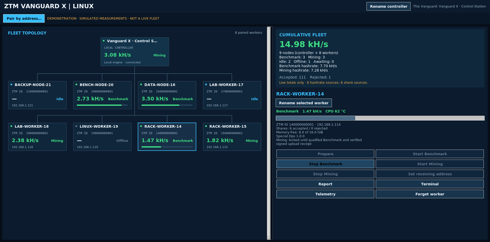
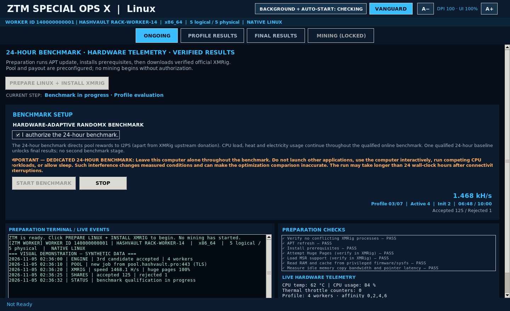

# ZTM X

**ZTM X** is the performance-research, benchmarking, and fleet-management ecosystem developed by **I2PS Engineering**. It brings together two applications—**ZTM Special Ops X** and **ZTM Vanguard X**—for **Linux and macOS**.

ZTM X is designed to understand the sustained performance of individual machines, support authorized workloads, and provide a unified view of connected systems. Its focus is measured results, clear operator control, and reliable reporting.

*ZTM Vanguard X — fleet dashboard demonstration. Displayed machine activity and measurements are illustrative.*

**I2PS Engineering**  
*Different machines. Different capabilities. Same destination.*

## Two applications. Two platforms.

| Application | Linux | macOS |
| :--- | :--- | :--- |
| **ZTM Special Ops X** | Native benchmarking, machine telemetry, reporting, and authorized Mining | Native benchmarking and reporting built on the **original ZTM Special Ops macOS native engine**, with platform-appropriate workload support |
| **ZTM Vanguard X** | Graphical fleet controller with an independent local workload engine | Graphical fleet controller integrating the **original ZTM Special Ops macOS native engine** for its local workloads |

**Special Ops X** works at the individual machine. **Vanguard X** brings those machines together while also operating as a capable local machine in its own right. Neither application is a substitute for the other: each has a defined role in the same ecosystem.

## ZTM Special Ops X

Special Ops X is the machine-level application for sustained processor research and supervised workloads. It provides a consistent interface for preparing a system, conducting a Benchmark, observing its behavior, reviewing measured results, and managing authorized Mining.

Its principal capabilities include:

- **Native machine benchmarking:** performance evaluation appropriate to the operating system and available hardware.
- **Sustained-performance research:** results that prioritize observed operation over brief peak readings.
- **Telemetry:** live workload and system measurements when supported by the machine.
- **Reporting:** organized Benchmark findings and machine-specific records.
- **Operator control:** explicit workload actions, visible status, and supervised stopping.
- **Authorized Mining:** a separate activity governed by the system's authorization requirements.

Hardware capabilities vary. ZTM X distinguishes available measurements from unsupported sensors or features and does not present simulated values as real machine results.

## ZTM Vanguard X

Vanguard X is the visual control center for a fleet of ZTM X machines. It presents a connected-machine overview, per-worker status, cumulative fleet measurements, and access to individual workload controls.

Vanguard X also has its **own local engine**. The controller machine can perform supported local Benchmark and authorized Mining operations without requiring a second application to be opened for its own workload.

The interface is designed around:

- **Fleet overview:** identifiable controller and worker nodes with clear workload states.
- **Direct pairing:** operator-initiated connections to selected machines.
- **Cumulative statistics:** measured contributions from reporting machines.
- **In-application Terminal and Telemetry:** accessible as views within Vanguard X, not as unrelated external windows.
- **Local and remote controls:** actions available according to the selected machine's permissions and state.
- **Responsive layout:** worker cards and fleet information that adapt to the available display.

Vanguard X keeps Benchmark, Mining, Idle, and disconnected states distinguishable. Values shown in the fleet view represent the machines and workloads actually reporting to the application.

## Benchmark and results

ZTM X is built around a simple research principle: **the best configuration for a machine is the one supported by its measured results**.

A Benchmark captures relevant machine information, evaluates performance under workload, and presents results for review. Sustained qualification is distinct from an initial performance reading. Reports preserve the distinction between completed work, interrupted work, and information that could not be measured.

Results may include processor characteristics, workload performance, operational stability, memory information, and available system telemetry. The particular measurements depend on the platform and hardware.

The broader engineering research background is available in the [ZTM Special Ops research reference](https://github.com/I2PS-Engineering/ZTM_SpecialOps#readme).

## Mining and authorization

**Mining requires valid authorization.** A local Benchmark result, a submitted report, or a command from a fleet controller does not independently authorize Mining.

ZTM X keeps Benchmark and personal Mining separate, with explicit operator controls and clear status reporting. If authorization is unavailable, Mining remains restricted.

Personal Mining uses a public receiving address supplied by the operator. ZTM X does not require a wallet's recovery phrase or private keys. Information about Monero wallets is available from the [official Monero website](https://www.getmonero.org/).

## Platform experience

### Linux

Special Ops X provides the native machine application, with supported desktop and managed background operation. Vanguard X provides fleet management and its own local workload capability. Both are designed for the Linux environment with controls appropriate to supported hardware.

### macOS

Special Ops X uses the **original ZTM Special Ops macOS native engine**. Vanguard X integrates that native engine for its own local workload while adding the fleet-management interface.

The macOS experience is designed to respect the capabilities of the actual machine. Platform-specific features are used where supported; unavailable functions are not represented as active or verified.

## Connectivity, privacy, and control

Workers are connected through an intentional, operator-approved pairing experience. Workload actions are subject to authorization and appropriate access controls.

The applications provide relevant operating status and research reports without requiring disclosure of wallet private keys or recovery phrases. Operators should protect machine identities, exported reports, and access credentials.

Security-sensitive implementation details are not part of this public overview.

## Safety and licensing

Sustained computational workloads use electricity and generate heat. Operate ZTM X only on machines you own or are authorized to manage, and maintain appropriate cooling, monitoring, and system safeguards. No performance or Mining return is guaranteed.

ZTM X is **proprietary I2PS Engineering software**, intended for authorized, noncommercial use under the terms accompanying its distribution. Third-party components retain their respective licenses and notices.

---

**I2PS Engineering**  
*Built in Morocco, Engineered in the future.*

## ZTM Special Ops X GUI

*ZTM Special Ops X — Benchmark interface demonstration. Displayed measurements are illustrative.*